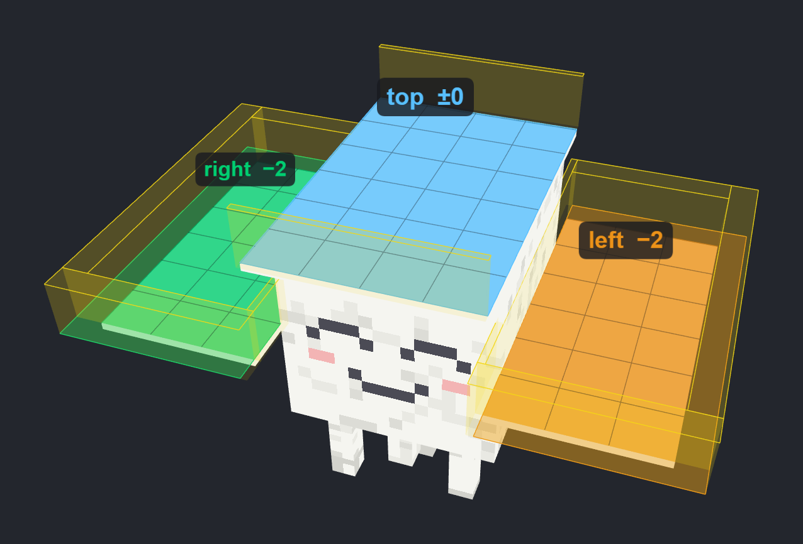
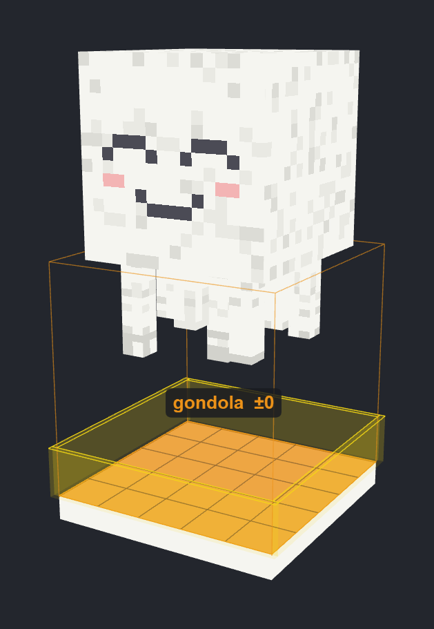

# Living Decks: Guide for Mod Authors and Data Packs

How to give a creature a deck: the deck file, the Blockbench plugin, saddles, animated bodies, access rules and beds.

This guide describes **Living Decks 0.0.1-beta19** (NeoForge 26.1.2) and the **Blockbench plugin 0.1.5 (beta6)**.
Living Decks is an alpha: file format and API can still change between versions.

**Contents**

1. [How it works in one minute](#1-how-it-works-in-one-minute)
2. [Quick start with the Blockbench plugin](#2-quick-start-with-the-blockbench-plugin)
3. [Quick start by hand](#3-quick-start-by-hand)
4. [The deck file](#4-the-deck-file)
5. [Zones: several build areas](#5-zones-several-build-areas)
6. [Parts: several decks on one creature](#6-parts-several-decks-on-one-creature)
7. [Saddles](#7-saddles)
8. [A build the creature spawns with](#8-a-build-the-creature-spawns-with)
9. [Following the animated body](#9-following-the-animated-body)
10. [Who may do what: access rules](#10-who-may-do-what-access-rules)
11. [Beds and hostile creatures](#11-beds-and-hostile-creatures)
12. [Using the API from your mod](#12-using-the-api-from-your-mod)
13. [The Blockbench plugin in detail](#13-the-blockbench-plugin-in-detail)
14. [Testing and troubleshooting](#14-testing-and-troubleshooting)

---

## 1. How it works in one minute

- A deck is **one JSON file**: `data/<namespace>/livingdecks/decks/<name>.json`. Put it into the resources of your mod or into a data pack.
- You need **no code and no dependency**. If Living Decks is not installed, nobody reads the file.
- The file says which creature carries the deck, where the floor is and where players may build.
- All sizes are **blocks in the model space of the creature**, the way the model sits in Blockbench (pixels / 16) in its rest pose:
  origin between the feet, **+x right, +y up, -z front** (the direction the head points).
- One file per creature type. If there are several, the first one by file id wins and the log says so.
- Code is optional and only needed for extras: a body pose for the server, access rules, your own saddle model.

## 2. Quick start with the Blockbench plugin

The plugin lets you mark the deck in the model instead of typing numbers. Install it first: see
[chapter 13](#13-the-blockbench-plugin-in-detail).

1. Open the model of your creature. For a creature from another mod: **Living Decks > Open Model from Mod (.jar)...**
   If the deck should follow a GeckoLib bone in the game, select that bone now.
2. **Living Decks > Create Deck...** Enter the creature (for example `minecraft:happy_ghast`), choose a visible floor if you want one
   (for example `minecraft:spruce_planks`), the railing and the saddle. Size and height are suggested from the model: on top, centered.
3. Add more build areas with **Add Zone...**, or put another cube into the group `living_deck` yourself. Move and resize zones like
   any cube. For another deck somewhere else on the creature (head, tail, gondola) use **Add Part...**
4. **Align Zones to Main Floor** puts all zones onto the grid of the main floor. **Check Deck** lists what the mod would reject.
5. **Export Deck File (.json)...** for `data/<namespace>/livingdecks/decks/` of your mod, or **Export as Data Pack (.zip)...** and
   put the zip into the `datapacks` folder of a world.



*The preview in Blockbench: every colored area is a zone, yellow is the invisible railing. This is the example
[`happy_ghast_three_zones`](examples).*

## 3. Quick start by hand

The smallest useful file. The Happy Ghast gets a 6 x 6 deck with a visible plank floor, only while it wears a platform saddle:

```json
{
  "entity": "minecraft:happy_ghast",
  "floor": { "y": 4.125, "from": [-3.5, -3.5], "to": [3.5, 3.5], "block": "minecraft:spruce_planks" },
  "build": { "from": [-3, -3], "to": [3, 3], "max_height": 6, "max_blocks": 216 },
  "rim": true,
  "saddle": true
}
```

Try it:

1. Make a data pack: a folder `MyDecks` with the deck file as `MyDecks/data/mydecks/livingdecks/decks/happy_ghast.json` and a
   `MyDecks/pack.mcmeta` (this one is for Minecraft 26.1):

   ```json
   { "pack": { "description": "My decks", "min_format": 101, "max_format": 101 } }
   ```
2. Put the folder into `saves/<world>/datapacks/` and load the world (or run `/reload`).
3. Craft the platform saddle (3 planks on top, below them leather, saddle, leather) and right-click a Happy Ghast with it.
4. Press **F3+B**: the floor is drawn white, the railing yellow.

A ready-made example pack is in [`examples/`](examples).

## 4. The deck file

A larger example: the Ravager King of the mod Kristallbosse, a giant that carries a fortress on its back.

```json
{
  "entity": "kristallbosse:verwuester_koenig",
  "pivot": [0.0, 9.5, 0.0],
  "floor": { "y": 11.5, "from": [-9.0, -14.2], "to": [9.0, 14.2] },
  "build": { "from": [-8, -13], "to": [8, 13], "max_height": 20, "max_blocks": 4096 },
  "rim": true,
  "solids": [
    { "from": [7.6, 11.3, 12.45], "to": [11.6, 13.9, 16.45] }
  ],
  "bone": "body",
  "structure": { "id": "kristallbosse:festung_verwuester_koenig", "rotation": "clockwise_90" }
}
```

| Field | Required | Meaning |
|---|---|---|
| `entity` | yes | The creature type that carries the deck. |
| `floor` | yes | The main floor. `y` is its top; layer 0 of the block grid starts here. Together with `build`: its rectangle `from` [x, z] to `to` [x, z], one block thick. Optional: `block` draws a visible plate with the texture of that block, `thickness` sets how thick the plate is (1/16 to 1, default 0.125). With `zones` only: `x` and `z` shift the block grid (each -1 to 1), see [chapter 5](#5-zones-several-build-areas). |
| `build` | yes, or `zones` | The build area in whole blocks, `to` is exclusive. It must lie on the floor rectangle. Optional: `max_height` (1 to 64 layers) and `max_blocks` (1 to 16384); without them the server config decides. |
| `zones` | yes, or `build` | Build areas with their own shape and level (up to 32), instead of `build` or in addition to it. |
| `max_blocks` | no | Block limit of the whole deck (1 to 16384). |
| `pivot` | no | The point the body tilts around, usually the pivot of the body bone. Default: the middle of the floor. |
| `rim` | no | An invisible railing at free edges. It stands on the strip between build area and floor edge; without such a strip it hangs as a thin wall on the outside of the edge. Its height comes from the server config. |
| `safe_drop` | no | Only with several zones: how many blocks lower a neighboring zone may be so that there is no railing between them (0 to 256, default 3: the height you can fall without damage). |
| `solids` | no | Solid boxes `from` [x, y, z] to `to` [x, y, z], for towers and walls of the model. Players stand on them and bump into them. Up to 64. |
| `bone` | no | Name of the GeckoLib bone the deck sits on, as in Blockbench (up to 64 characters). The deck follows its animation. |
| `parts` | no | More decks on the same creature (up to 16), see [chapter 6](#6-parts-several-decks-on-one-creature). |
| `saddle` | no | The deck only exists while the creature wears a saddle, see [chapter 7](#7-saddles). |
| `structure` | no | A build the creature carries from the start, see [chapter 8](#8-a-build-the-creature-spawns-with). |

Good to know:

- A file with errors is skipped and reported in the log (`Couldn't parse data file ...`). The world still loads.
- A data pack can **replace** a deck file by using the same file id, or **switch it off** with
  `"neoforge:conditions": [{"type": "neoforge:never"}]`.
- If your data pack adds a deck for a creature of another mod, add
  `"neoforge:conditions": [{"type": "neoforge:mod_loaded", "modid": "<mod>"}]` so the log stays quiet when that mod is missing.
- What players may build is decided by Living Decks: building and decoration blocks, workstations, the anvil, chests, barrels,
  banners, lecterns and beds. The block tags `#livingdecks:not_buildable` and `#livingdecks:buildable` let a data pack forbid blocks
  or allow blocks that are left out by default. Blocks with an inventory or their own logic (furnaces, hoppers, signs ...) can never
  be allowed this way.
- Everything built on a deck is saved with the creature. **When the creature dies, the build is gone** (chest contents and the saddle
  drop).

## 5. Zones: several build areas

A deck does not have to be one rectangle. With `zones` it can be several build areas, each with its own **shape** and on its own
**level**: back, flanks, stern, a ring around the body.

```json
{
  "entity": "minecraft:happy_ghast",
  "floor": { "y": 4.125, "block": "minecraft:spruce_planks" },
  "zones": [
    { "max_height": 8,
      "pattern": [ ".####.", "######", "######", "######", "######", ".####." ] },
    { "y": -3, "max_height": 3, "margin": 0.5, "block": "minecraft:dark_oak_planks",
      "pattern": [ "##########", "##########", "##########", "###....###", "###....###",
                   "###....###", "###....###", "##########", "##########", "##########" ] },
    { "y": 1, "max_height": 4, "thickness": 1.0, "origin": [-3, -6],
      "pattern": [ "..##..", ".####.", "######" ] },
    { "y": -5, "max_height": 3, "margin": 0.5, "from": [-1, 5], "to": [1, 8] }
  ],
  "max_blocks": 512,
  "rim": true,
  "saddle": true
}
```

This gives the ghast a rounded deck on its back, a gallery around its body three blocks lower, a raised bow in front and a small
walkway at the stern.

| Field of a zone | Required | Meaning |
|---|---|---|
| `from`, `to` | one of the two | A rectangle in cells [x, z], `to` is exclusive. |
| `pattern` | one of the two | A shape seen from above, the head of the creature at the top. One string per row: `#` is build area, `.` is free. The first row is the front (-z), the first character is the left side (-x). Up to 256 x 256; all patterns of a file together up to 16384 characters. |
| `origin` | no | Only with `pattern`: the cell [x, z] of the first character of the first row. Default: the pattern is centered on the origin. |
| `y` | no | Level of this zone above (+) or below (-) the main floor, in whole blocks (-128 to 128, default 0). |
| `max_height` | no | Build height in layers (1 to 64). |
| `margin` | no | How far the floor reaches beyond the cells at free edges: one number or `[left, front, right, back]` (default 0). |
| `rim` | no | Railing at the free edges of this zone (default: like the deck). |
| `block`, `thickness` | no | The visible floor of this zone (default: like `floor`). |

How zones behave:

- **One grid.** All zones share one block grid, so blocks fit together across zones. Zones are only offset by whole blocks.
  A triangle is a staircase of whole cells.
- **Shifting the grid.** With `floor.x` and `floor.z` the grid as a whole can be shifted (each -1 to 1 blocks).
  `"floor": { "y": 2.4, "x": 0.5 }` with cells from -2 to 1 gives a deck that is 3 blocks wide and centered on the creature.
- **Free edges.** An edge is free when the floor does not continue behind it. It is *not* free where a neighboring zone is on the
  same level, up to 3 blocks lower (`safe_drop`) or one block higher: there you walk, drop or step across. Margin and railing exist
  only at free edges.
- **Stacking.** The floor of a zone is one block thick. If it lies inside the build space of a zone below, it is the ceiling there.
- **Building at an edge.** You can place blocks against the side of a higher floor and below it, where that space belongs to another
  zone: a ladder up to the back, a lantern under the upper platform.
- **Visible floor.** The plate is only as thick as `thickness`, the floor itself one block. For a zone that lies higher than its
  neighbors (a step like the bow above), `"thickness": 1.0` looks right.
- `solids`, `pivot` and `bone` apply to the whole deck. The number of a zone (for `structure.zone`) is its position in the file;
  with `build` present, `build` is number 0 and the first entry of `zones` is number 1.
- Shapes that are too ragged (more than 2048 separate rectangles of floor and railing, such as a checkerboard) are skipped with a
  message in the log.

## 6. Parts: several decks on one creature

`parts` adds more decks to the same creature: one on the head that turns with the head, a gondola under the belly, a lookout above
the back. What the file contained so far describes the **main deck**; every entry under `parts` is a full deck of its own.

```json
{
  "entity": "minecraft:happy_ghast",
  "floor": { "y": 4.125, "block": "minecraft:spruce_planks" },
  "zones": [ { "from": [-3, -3], "to": [3, 3], "max_height": 6 } ],
  "rim": true,
  "saddle": true,
  "parts": [
    {
      "name": "gondola",
      "floor": { "y": -5.0, "x": 0.5, "z": 0.5, "block": "minecraft:dark_oak_planks", "thickness": 0.5 },
      "zones": [ { "from": [-3, -3], "to": [2, 2], "max_height": 5 } ],
      "rim": true,
      "max_blocks": 96
    },
    {
      "name": "lookout",
      "floor": { "y": 8.25, "x": 0.5, "block": "minecraft:spruce_planks" },
      "zones": [ { "from": [-1, 1], "to": [1, 3], "max_height": 3 } ]
    }
  ]
}
```

| Field of a part | Required | Meaning |
|---|---|---|
| `name` | yes | 1 to 32 characters from `a-z`, `0-9` and `_`, unique per creature. **The game saves what is built on the part under this name.** |
| `floor`, `zones` (or `build`) | yes | Like for a deck, with its own height `y` and its own grid shift `x`, `z`. |
| `bone` | no | The bone this part follows. |
| `rim`, `solids`, `structure`, `max_blocks`, `safe_drop` | no | Like for a deck, separately for each part. |

**Zone or part?**

| | Zone | Part |
|---|---|---|
| Grid | the grid of the main floor: blocks fit together across zones | its own, freely shifted |
| Height | whole blocks above or below the main floor | any |
| Movement | with the deck | with its own bone (head, tail, claw ...) |
| Block limit, starting build, railing | shared by the deck | its own |
| Transition | margin and railing depend on neighboring zones | none: parts know nothing of each other |

Rule of thumb: what belongs together and moves together is a set of zones. What sits elsewhere, moves differently or does not fit
the grid is a part.

- `entity` and `saddle` are set at the main deck only and apply to all parts.
- **The name is the storage key.** Renaming a part means starting empty; what was built stays stored under the old name and is back
  when the name returns. The order of the parts in the file may change freely.
- If one part has an error, the whole file is skipped. The log names the part (`parts[1] (lookout): ...`).
- Parts are not connected: a fence on one part does not connect to a fence on another, and their blocks may even overlap.
- **Limit of this version:** on the server, every part follows the body pose of the creature. Only the client follows the part's own
  bone, when drawing and for your own player. If a bone moves far on its own (a head during an attack), mobs and items on that part
  are still at the rest position for the server, and placing blocks there can be refused for a moment.
- Large builds belong on the main deck: the parts of a creature are always sent to the clients together.

## 7. Saddles

Like the platform saddles in ARK: with `"saddle"` the deck only exists while the creature wears a saddle.
**No saddle, no deck:** no floor, no building, no collision, nothing drawn.

| In the file | Meaning |
|---|---|
| `"saddle": true` | The platform saddle of Living Decks (`livingdecks:platform_saddle`). |
| `"saddle": "mymod:giant_saddle"` | Your own saddle item. |
| `"saddle": "#mymod:platform_saddles"` | Every item of an item tag. |
| `"saddle": { "item": "mymod:giant_saddle", "owner_only": true }` | Only the owner of a tamed creature may put it on and take it off (Minecraft's owner of tamed animals, as for wolves and horses). A creature without an owner then gets no saddle. |
| `"saddle": { "equipped": true }` | The creature gets the saddle once by itself: when it spawns, and also if it already existed (babies once they are grown). For bosses that carry their deck from the start. Can be combined with `item` and `owner_only`; with `owner_only` on a creature without an owner, nobody can take it off. |

How saddling works in the game:

- **Put on:** right-click the creature with the saddle (aim at the creature, not at a deck; not on babies). One item is used up.
  A saddle put on by hand keeps the creature from despawning.
- **Take off:** right-click with shears (not sneaking), only when nothing is built on any deck of the creature.
- **Death:** the saddle drops.
- If the saddle is taken off through `setSaddle` (see below) while something is built, the build stays stored on the creature and
  returns with the next saddle.
- With `equipped`, a creature that despawns naturally takes its saddle with it. It only drops on death, and no new one is handed out
  after it was taken off.

### Your own saddle model

Living Decks **does not draw the saddle**. The model of your creature belongs to your mod, and so does its saddle. Three ways to
handle it:

**1. No model at all.** Give the deck a visible floor with `floor.block`. The plate only shows while the saddle is on. Good for vanilla
creatures and quick data packs.

**2. A saddle that is part of your model.** Build the saddle into your model, for example as its own bone, and show it only while the
creature wears one. `LivingDecksApi.saddle(entity)` returns the saddle that is on (an empty stack if there is none), also on the
client. With GeckoLib 5 it can look like this in your entity renderer:

```java
// in class GiantTurtleRenderer<R extends LivingEntityRenderState & GeoRenderState> extends GeoEntityRenderer<GiantTurtle, R>
private static final DataTicket<Boolean> SADDLED = DataTicket.create("mymod_saddled", Boolean.class);

@Override
public void addRenderData(GiantTurtle animatable, @Nullable Void relatedObject, R renderState, float partialTick) {
    renderState.addGeckolibData(SADDLED, MyDeckCompat.isSaddled(animatable));
}

@Override
public void adjustModelBonesForRender(RenderPassInfo<R> renderPassInfo, BoneSnapshots snapshots) {
    final boolean saddled = Boolean.TRUE.equals(renderPassInfo.renderState().getGeckolibData(SADDLED));
    snapshots.ifPresent("saddle", bone -> bone.skipRender(!saddled).skipChildrenRender(!saddled));
}
```

```java
// MyDeckCompat: the only class that touches Living Decks, see chapter 12
public static boolean isSaddled(Entity entity) {
    return !LivingDecksApi.saddle(entity).isEmpty();
}
```

**3. Your own inventory with a saddle slot,** like in ARK. Put the saddle on and take it off from your own menu, on the server:

```java
LivingDecksApi.setSaddle(host, stack);            // put it on (one item of the stack)
LivingDecksApi.setSaddle(host, ItemStack.EMPTY);  // take it off
```

`setSaddle` runs no checks: not the item, not the owner, not the access rules, and not whether something is still built. Your menu
decides who may do it. It does not hand back the old saddle either: ask `saddle(host)` before you replace it.

With your own taming system, do not use `owner_only`. Register an access rule for the action `saddle` instead
([chapter 10](#10-who-may-do-what-access-rules)).

## 8. A build the creature spawns with

`structure` places a build on the deck once, when the creature gets its deck (with a saddle: when it is saddled for the first time).
After that it belongs to the players: they can change or remove it, and nothing comes back.
Save the build with a structure block and put the file into `data/<namespace>/structure/<path>.nbt`.

```json
"structure": { "id": "mymod:turtle_hut", "rotation": "clockwise_90", "offset": [0, 0, 2], "zone": 0 }
```

- `rotation`: `none`, `clockwise_90`, `180` or `counterclockwise_90`, seen from above with the head of the creature at the front.
- `offset`: [x, y, z] in cells. Without it the build is centered on the rectangle of its zone, its lowest layer on the floor.
- `zone`: the number of the zone it stands on (default 0). A build may reach across several zones.
- Short form: just the id as a string, `"structure": "mymod:turtle_hut"`.
- The building rules apply: blocks that are not allowed on decks, or that reach beyond the build area, are left out and listed in
  the log.
- Chests and barrels keep their items, names or loot table. Banners keep their patterns, lecterns their book. Waterlogged blocks
  are placed dry.

## 9. Following the animated body

Without anything extra, a deck follows the position and rotation of the creature. Two things make it follow the animated body as
well. They complement each other.

**1. `bone` (GeckoLib, no code).** While the model is drawn, Living Decks records how the bone currently sits compared to its rest
pose, exactly as GeckoLib draws it. The client uses this for the blocks and for your own player. This exists on the client only:
the server knows no animations. If the model has no bone with that name, the log warns once.

**2. Body pose (code, optional).** For the server (mobs on the deck, checks) and for models without GeckoLib, your mod reports the
pose. Living Decks asks for it every tick, on the server and on the client. Both sides must get the same result, so compute it from
synced data and not from the animation on the client.

Without a dependency, as an IMC message in the `InterModEnqueueEvent` (mod bus). If Living Decks is not installed, the message
simply goes nowhere:

```java
modBus.addListener((InterModEnqueueEvent event) ->
        InterModComms.sendTo("mymod", "livingdecks", "register_pose", () -> Map.entry(
                Identifier.fromNamespaceAndPath("mymod", "giant_turtle"),
                (Function<Entity, float[]>) entity -> entity instanceof GiantTurtle turtle
                        ? new float[] { turtle.tilt(), 0.0f, 0.0f, turtle.lift() } // rotX, rotY, rotZ (degrees), offsetY (blocks)
                        : null)));                                                // null = rest pose
```

With a dependency:

```java
LivingDecksApi.registerPose(Identifier.fromNamespaceAndPath("mymod", "giant_turtle"),
        entity -> new DeckPose(rotX, rotY, rotZ, offsetY)); // degrees as in Blockbench, around the pivot; then blocks up
```

If a pose function throws an exception or returns fewer than 4 values, it is reported once in the log and not asked again until
the game restarts.

## 10. Who may do what: access rules

Without a rule, everybody may do everything on every deck that the building rules allow. A mod can restrict that for the decks of
its own creatures (only the owner of a tamed creature builds and opens chests) or for all decks (claim and protection mods). Rules
are asked on the server before every action. If several rules apply, all of them must agree. A rule that throws an exception counts
as "no". A player who is not allowed gets a short message above the hotbar.

| Action | Name | What |
|---|---|---|
| Place | `place` | place a block, use a spawn egg |
| Break | `break` | break a block (also chests with their contents) |
| Use | `use` | doors, trapdoors, fence gates, workstations, anvil, reading a lectern |
| Open | `open` | chests and barrels, putting a book on a lectern or taking it |
| Saddle | `saddle` | put the saddle on or take it off |
| Sleep | `sleep` | sleep in a bed and set the spawn point there |

Without a dependency, as the IMC message `register_access`. The key is the creature type, or `"*"` for all decks. The value is one
`BiPredicate<Player, Entity>` (player, creature with the deck) for all actions, or a `Map<String, BiPredicate<Player, Entity>>` per
action with `"*"` for all others. An action that is missing is allowed. Only for `sleep`, the rule for `use` is asked when there is
no rule of its own.

```java
modBus.addListener((InterModEnqueueEvent event) ->
        InterModComms.sendTo("mymod", "livingdecks", "register_access", () -> Map.entry(
                Identifier.fromNamespaceAndPath("mymod", "giant_turtle"),
                Map.of("*", (BiPredicate<Player, Entity>) (player, host) -> isOwner(player, host),
                       "use", (BiPredicate<Player, Entity>) (player, host) -> true))));   // doors and workstations for everybody
```

With a dependency (the rule also gets the action and the cell in the block grid):

```java
LivingDecksApi.registerAccess(Identifier.fromNamespaceAndPath("mymod", "giant_turtle"),
        (player, host, action, cell) -> action == DeckAction.USE || isOwner(player, host));
LivingDecksApi.registerAccess((player, host, action, cell) -> !inForeignClaim(player, host)); // for all decks
```

`LivingDecksApi.mayDo(player, host, action, cell)` asks the same rules, for mods that offer their own interactions on decks.
A rule can also learn which part an action is about: implement `DeckAccess.allows(player, host, part, action, cell)`.

## 11. Beds and hostile creatures

Beds on decks work like beds in the world, with two differences:

- The **spawn point** is the bed on the creature, not a place in the world. After death the player respawns next to that bed,
  wherever the creature is at that moment. If the creature has died or the bed is gone, the spawn point is lost.
- If the creature itself is a **monster that prevents sleeping** (Minecraft's "monsters nearby" rule), players can neither sleep nor
  set their spawn on it, except in Creative mode.

For your own tameable monster (a creature that extends Minecraft's `Monster`), override Minecraft's own method. Living Decks asks
exactly this one:

```java
@Override
public boolean isPreventingPlayerRest(ServerLevel level, Player player) {
    return !isTamed();   // a tamed creature lets players sleep on its back
}
```

Server owners can switch the rule off altogether with `beds.hostile_host_blocks` in the server config. To decide *who* may sleep on
a deck, use the access action `sleep`.

## 12. Using the API from your mod

Everything in this chapter is optional. Deck files and IMC messages need no dependency at all.

To call `LivingDecksApi` you compile against the Living Decks jar and declare an **optional** dependency in your
`neoforge.mods.toml`:

```toml
[[dependencies.mymod]]
    modId = "livingdecks"
    type = "optional"
    versionRange = "[0.0.1-beta18,)"
    ordering = "NONE"
    side = "BOTH"
```

Keep every call to the API in a class of its own and only touch that class when the mod is there:

```java
if (ModList.get().isLoaded("livingdecks")) {
    MyDeckCompat.init();   // the only class that imports dev.livingdecks.api
}
```

The API lives in `dev.livingdecks.api`:

| Method | What it does |
|---|---|
| `registerPose(type, provider)` | body pose for a creature type ([chapter 9](#9-following-the-animated-body)); call it in your mod constructor |
| `registerAccess(type, access)`, `registerAccess(access)` | access rules ([chapter 10](#10-who-may-do-what-access-rules)); call it in your mod constructor |
| `mayDo(player, host, action, cell)` | ask the access rules (server); also with the name of a part |
| `saddle(entity)` | the saddle the creature wears (empty stack = none), on server and client |
| `needsSaddle(entity)` | does the deck file of this creature require a saddle? |
| `setSaddle(host, stack)` | put a saddle on or take it off, without checks (server) |
| `hasDeck(entity)` | does this creature carry a deck right now? |
| `parts(entity)` | the names of the parts it carries right now |
| `definition(entity)` | the deck file as an object |
| `gridToWorld(entity, grid)`, `worldToGrid(entity, world)` | convert between the block grid of the deck and the world; also with the name of a part |

The names of the IMC messages and of the actions are fixed. The Java API can still change between alpha versions.

## 13. The Blockbench plugin in detail

**Requirements:** Blockbench 5.0 or newer (tested with the desktop app 5.2.2; the web app is untested).

### Install

1. Download [`living_decks.js`](living_decks.js) from this repository. Keep the file name: Blockbench requires it to match the id
   of the plugin.
2. In Blockbench: **File > Plugins**, then the icon **Load Plugin from File** at the top, and pick the file.
   Blockbench loads the plugin from this place on every start, so do not move or delete the file afterwards.
3. A new menu **Living Decks** appears in the menu bar next to *Tools*.

To update, load the new file the same way; open models keep their decks. To remove it: File > Plugins > Installed > Living Decks >
Uninstall.

### What you see in the outliner

```
body                    bone of the model
  living_deck           group: the main deck
    top                 cube: zone 0, the main floor (always the first zone)
    left                cube: zone 1
    right               cube: zone 2
    bow                 group of cubes: one zone with a free shape (L, ring, triangle of steps)
    solids              group: solid boxes (towers, walls), one per cube
  head                  bone of the model
    living_deck_head    group: a part, here inside the head bone
      main              cube: its main floor
```

| In the model | In the deck file |
|---|---|
| top of a cube | floor of the zone. The first zone sets `floor.y`, all others are whole blocks above or below it (`y`) |
| corner of the main floor (x, z) | the grid of the deck: if it is not on whole blocks, the rest goes into `floor.x` and `floor.z` |
| footprint (x, z) | the cells of the zone: `from`/`to`, or `pattern` with `origin` for a free shape |
| thickness of the cube | `thickness` of the visible floor (1 to 16 pixels) |
| order in the outliner | number of the zone |
| bone that contains the group | `bone` and `pivot` (can be switched off) |
| Zone Settings (right-click) | `max_height`, `margin`, `rim`, `block` |
| Deck Settings | `entity`, `floor.block`, `rim`, `safe_drop`, `max_blocks`, `saddle`, `structure`, `pivot` |
| another deck group with a part name | an entry under `parts` |

16 pixels are one block, as for GeckoLib models in game size. If the game draws a vanilla model larger, change
**Blocks per 16 pixels** in the deck settings. The axes are those of the mod: +x right, +y up, -z front (north in Blockbench).
The group `living_deck` and its cubes are **not exported with the model**: they do not show up in your `.geo.json`.

### Adding a part

1. Select the bone the part should sit on (for example `head`). It also works without a bone: the part then moves with the body.
2. **Living Decks > Add Part...** Enter name, corner, size and height. The suggestion is: on top of the bone, centered, named like
   the bone.
3. The outliner now has a group `living_deck_<name>` with its main floor. Zones, settings and aligning work as for the main deck:
   every menu entry applies to **the deck in which something is selected** (nothing selected: the main deck).

Creature, saddle, scale, namespace and file name are set at the main deck and apply to all parts. The name of a part is the field
*Name of the part* in *Deck Settings*; the name of the group in the outliner is free. Clearing the field turns a part into the main
deck (there can only be one).

### The menu

| Entry | |
|---|---|
| Open Model from Mod (.jar)... | open the model of a creature from a mod file (GeckoLib models), with its texture |
| Create Deck... | add the group `living_deck` with a first zone: the main deck, with railing and saddle |
| Add Zone... | another zone in the selected deck |
| Add Part... | another deck on the same creature, inside the selected bone |
| Zone Settings... | build height, margin per side, railing and visible floor of the selected zones |
| Deck Settings... | for the selected deck: name of the part, railing, safe drop, bone, pivot, starting build. At the main deck also creature, saddle and scale |
| Align Zones to Main Floor | move all zones of the selected deck onto the grid of its main floor |
| Snap Zones to Block Grid | move everything onto whole blocks of the model (no grid shift) |
| Check Deck | errors and hints for all decks, with an overview of the zones |
| Export Deck File (.json)... | the deck file for the whole creature (also under File > Export) |
| Export as Data Pack (.zip)... | a ready-to-use data pack for Minecraft 26.1 |
| Copy Deck File to Clipboard | the deck file as text |
| Import Deck File... | read a deck file and build its decks, parts under their bones. Replaces all decks of the model (also under File > Import) |
| Show Deck Preview, Show Build Volumes | switch the preview on and off |
| How It Works | a short help inside Blockbench |

Everything can be undone. With Blockbench set to German, the plugin is in German.

### The preview



*The example [`happy_ghast_gondola`](examples): a deck that hangs below the ghast as a gondola, with its build space.*

- **Colored area** per zone: its cells with the block grid; paler: the **margin**.
- **Yellow:** the invisible railing at free edges.
- **Lines going up:** the build space (`max_height`). Below another zone it ends under that floor.
- **Label:** the name of the zone and its level compared to the main floor; for a part with its name in front.

The preview is computed the way the mod does it. All decks of the model are shown at once, each following the bone of its group,
also in animations. Like other helper lines, it does not show up in screenshots made with Blockbench's own screenshot function.

### Creatures of other mods

**Living Decks > Open Model from Mod (.jar)...** lists the GeckoLib models inside a mod file (`assets/<modid>/geckolib/models/...`,
in older mods `assets/<modid>/geo/...`) together with the creatures from its language file. Pick a model and a creature; the model
opens as a new project, with its texture if there is one with the same name, and the entity id is already filled in for
*Create Deck*.

- The `.jar` is only read, never changed. The opened model is a copy: save it as a `.bbmodel` if you want to keep it.
- The entity id is a suggestion based on the file name. In the game, `/summon` with the Tab key lists all ids.
- Some mods draw their creatures from their own data inside the model file. Such a model opens with its bones only, without visible
  cubes; the plugin says so. You can still create the deck and put it into a bone, with size and height entered by hand.
- Mods that build their models **in code** have no model file. Create an empty model (File > New > Bedrock Entity), use
  *Create Deck* and enter size and height by hand. In the game, F3+B shows the outline of the creature.
- Vanilla creatures are not in a `.jar` with model files. Blockbench has templates for them (File > New > Bedrock Entity).
- Mind the license of a mod before you pass on its model. The deck file itself contains nothing of the model.

### Good to know

- The settings are stored in the `.bbmodel`, only on the deck group and its zones. If the model is saved **without the plugin**, the
  settings are lost (the cubes stay).
- Decks sit straight in the model: rotated cubes or rotated groups above them are reported as errors.
- One main deck and up to 16 parts per model. Zones are cubes; meshes do not count.
- A duplicated deck group is a second main deck at first, and *Check Deck* says so. Enter a part name in *Deck Settings* to make it
  a part.
- If a deck file has a `bone` but no `pivot`, the mod uses the middle of the floor as pivot. After an import the plugin writes the
  pivot of the bone instead. If you want the middle: *Deck Settings > Pivot > Own value*.
- What an imported file contains besides the deck (such as `neoforge:conditions`) is kept on export.
- For scripts: `window.LivingDecks` (`findRoot`, `findRoots`, `findMain`, `readAll`, `compile`, `createDeck`, `addZone`,
  `setDeckSettings`, `alignZones`, `snapZones`, `importDeck`, `packFiles`, `readMod`, `openModModel`).

**Not in the plugin yet:** drawing zones with the mouse, a preview of the starting build, a check whether two decks overlap, data
packs for other Minecraft versions.

## 14. Testing and troubleshooting

- **F3+B** shows the floor (white), the railing (yellow) and the solid boxes of a deck.
- `/reload` applies changed deck files right away, for all players.
- The log names every problem with the file and the field (`floor`, `zones[1]`, `parts[1] (lookout)` ...). Search it for
  `Living Decks`, `Deck` and `Couldn't parse data file`. Typical lines:

  ```
  Living Decks: 3 deck file(s) loaded
  [Server] Deck mydecks:giant_turtle: entity type mymod:giant_turtle does not exist - skipped
  Couldn't parse data file 'mydecks:happy_ghast' ... zones[1]: pattern without '#': the zone would have no build area
  Living Decks: the model of mymod:giant_turtle has no bone 'bodi' ("bone" in the deck file) - the deck follows the body pose
  Living Decks: structure mymod:turtle_hut: not allowed on decks and left out: minecraft:furnace x1
  ```

| Problem | Likely cause |
|---|---|
| Nothing happens after installing | Living Decks adds no creatures. You need a mod or data pack with a deck file. |
| The creature has no deck | The deck needs a saddle (`saddle`), the file has an error (see the log), or another file for the same creature type won. |
| The deck does not follow the animation | The bone name is wrong (the log warns once), the creature has no GeckoLib model, or GeckoLib is missing on the client. |
| The deck sits too high, too low or off-center | Sizes are in blocks of the model space (pixels / 16). Check `floor.y`; for odd widths shift the grid with `floor.x` / `floor.z`. |
| A block cannot be placed | It is outside the build area, above `max_height`, over `max_blocks`, or a block type that is not allowed on decks. |
| The starting build is incomplete | Blocks that are not allowed or reach beyond the build area are left out. The log lists them. |
| A part lost its blocks | It was renamed. Blocks are stored under the name of the part. |
| Players cannot sleep on the creature | It counts as a monster nearby ([chapter 11](#11-beds-and-hostile-creatures)). |

**Limits of this alpha that matter when you design a creature**

- There is no built-in way up yet: players fly, throw an ender pearl or build up next to the creature. Plan your own way up if your
  creature needs one.
- No redstone, liquids, falling blocks or plant growth on decks.
- Not placeable yet: furnaces, hoppers, signs, ender chests, shulker boxes, trapped chests, heads and bells, also inside a starting
  build.
- A deck always lies level in the rest pose of the model.
- Decks do not collide with other decks, and a creature with a deck is not carried by another deck.
- On the server, parts follow the body pose only ([chapter 6](#6-parts-several-decks-on-one-creature)).
- Not tested on a dedicated server yet.
