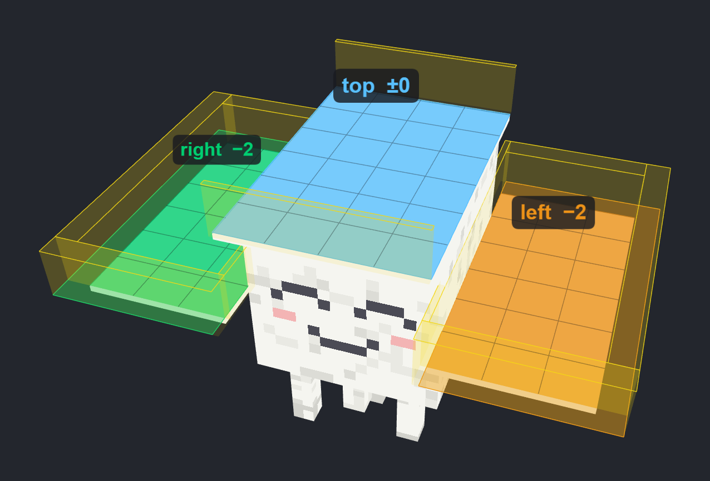

# Living Decks: Blockbench plugin and modding guide

**Living Decks** is a Minecraft mod (NeoForge 26.1.2) that gives big creatures a **deck**: players stand on it, ride along while the
creature walks and animates, and build on it. The mod adds no creatures of its own. Mods and data packs decide which creatures get
a deck, with one JSON file each.

This repository has what you need to give a creature a deck:

| | |
|---|---|
| [`living_decks.js`](living_decks.js) | A **Blockbench plugin**: mark the deck right in the model of your creature, see what the mod makes of it and export the deck file. |
| [`GUIDE.md`](GUIDE.md) | The **guide** for mod authors and data packs: the deck file, zones, parts, saddles, starting builds, animated bodies, access rules, beds and the API. |
| [`examples/`](examples) | Example models, their deck files and a ready-made data pack. |

The mod itself: [Living Decks on CurseForge](https://www.curseforge.com/minecraft/mc-mods/living-decks)

*The preview of the plugin: every colored area is a build area (a zone), yellow is the invisible railing, the labels show each zone's
level.*

## Install the plugin

1. Open [`living_decks.js`](living_decks.js) and click the download icon (**Download raw file**) at the top right of the code.
   Keep the file name `living_decks.js` and rename it back if your browser added a number: Blockbench requires it to match the id
   of the plugin.
2. In Blockbench: **File > Plugins**, then the icon **Load Plugin from File** at the top, and pick the file.
3. A new menu **Living Decks** appears in the menu bar next to *Tools*.

Blockbench loads the plugin from the place of the file on every start, so do not move or delete it afterwards.

| Plugin | Blockbench | Living Decks (mod) |
|---|---|---|
| 0.1.5 (beta6) | 5.0 or newer, tested with the desktop app 5.2.2 | beta16 or newer; parts need beta17 or newer |

## Five steps to a deck

1. Open the model of your creature. For a creature from another mod: **Living Decks > Open Model from Mod (.jar)...**
2. **Living Decks > Create Deck...** Enter the creature (for example `minecraft:happy_ghast`), then choose floor, railing and saddle.
   Size and height are suggested from the model.
3. Add more build areas with **Add Zone...** and more decks on other bones (head, tail, gondola) with **Add Part...**
4. **Check Deck** lists what the mod would reject.
5. **Export Deck File (.json)...** for your mod, or **Export as Data Pack (.zip)...** for the `datapacks` folder of a world.

The details are in the guide: [the plugin](GUIDE.md#13-the-blockbench-plugin-in-detail),
[the deck file](GUIDE.md#4-the-deck-file), [saddles and your own saddle model](GUIDE.md#7-saddles),
[the API](GUIDE.md#12-using-the-api-from-your-mod).

## What the plugin does

- **Zones as cubes.** A group `living_deck` holds the deck; every cube in it is a build area. Its top is the floor, its footprint the
  cells. Free shapes (L, ring, a triangle of steps) are groups of cubes.
- **Parts.** Several decks on one creature, each with its own grid and its own bone, so a deck on the head turns with the head.
- **Preview as the mod computes it:** cells, margin, the invisible railing at free edges and the build volume, for all decks at once
  and following their bones in animations.
- **A grid that fits the creature.** The main floor may sit anywhere; a deck that is 3 blocks wide ends up centered.
- **Checks before the game does.** *Check Deck* lists everything the mod would reject or that looks unintended.
- **Export** as a deck file, to the clipboard or as a data pack. **Import** existing deck files to change them.
- **Models from mod files.** Opens the GeckoLib model of a creature straight from the `.jar` of its mod.
- English and German. Everything can be undone.

## Examples

See [`examples/`](examples): a ghast with three zones, and a ghast with a gondola hanging below it, including the data pack to try
it in the game.

## Status

The plugin is a beta for an alpha mod. The deck files it writes are checked against the mod's own file reader: 89 deck files, with
94 parts and 390 zones in them, come out of the plugin exactly as the mod reads them, and files at the edges of the rules are rejected
by both alike. In Blockbench 5.2.2 (desktop app, Windows) creating decks, zones and parts, the settings, the preview, the checks,
import and undo were tested by hand.

Not tested: the web app of Blockbench, Blockbench versions before 5.2, macOS and Linux.

Found a bug or have an idea? Open an issue here or leave a comment on the [mod page](https://www.curseforge.com/minecraft/mc-mods/living-decks).

## Credits

Idea and design: xxXShindaXxx. Claude, Anthropic's AI assistant, helped with the code.

## License

Copyright (c) 2026 xxXShindaXxx. All rights reserved.

The plugin is free to use, also for commercial projects. Everything you create or export with it is yours, and the example files may
be used freely. Redistributing or re-uploading the plugin itself is not permitted. The full terms are in [`LICENSE`](LICENSE).

Blockbench belongs to its authors. Minecraft is a trademark of Mojang AB. This project is not affiliated with either.
